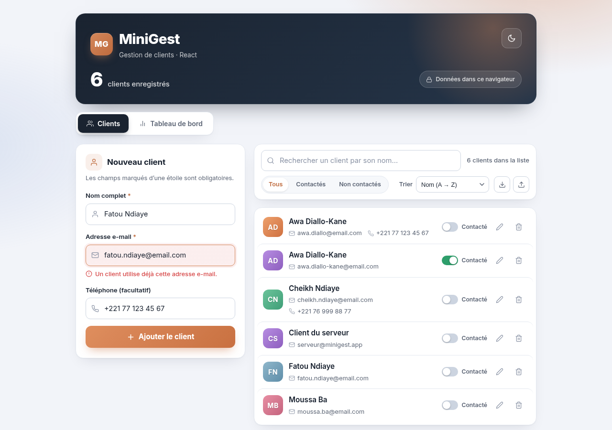

# MiniGest — Gestion de clients en React (v1.1)

Application de gestion de clients développée en **React 18**, conforme au cahier des charges
v1.1 (niveaux 1, 2 et 3 — tests T01 à T18). Le fichier `index.html` est **totalement autonome** :
React, ReactDOM et le code applicatif y sont intégrés — aucun `npm install`, aucun build,
aucune dépendance externe au moment de l'exécution.

**Démo en ligne : https://minigest-ruby.vercel.app** · Code source : https://github.com/cheickfaza/minigest

## Fonctionnalités

**Niveau 1 — gestion de base**
- Ajout d'un client (nom, e-mail, téléphone facultatif)
- Affichage complet de la liste (cartes avec initiales colorées)
- Recherche en direct par nom, insensible à la casse
- Suppression d'un client
- Compteur du nombre total de clients

**Niveau 2 — qualité des données**
- Validation bloquante : nom de 2 à 60 caractères, e-mail au format valide, messages d'erreur sous chaque champ
- Contrôle des doublons par e-mail, insensible à la casse
- Sauvegarde automatique dans le navigateur (`localStorage`) — la liste survit au rechargement

**Niveau 3 — évolutions v1.1**
- **Édition d'une fiche** : bouton « Modifier », formulaire pré-rempli, mêmes règles de validation, l'e-mail de la fiche éditée n'est pas un doublon
- **Tri de la liste** : nom (A → Z) ou ajout récent d'abord
- **Statut « contacté »** : interrupteur sur chaque fiche + filtres Tous / Contactés / Non contactés
- **Export / import CSV** : format `;` UTF-8 avec BOM (lisible dans Excel), validation ligne à ligne à l'import, doublons et lignes invalides ignorés avec bilan
- **Suppression confirmée** : boîte de dialogue (fermeture par Échap) + bouton « Annuler » pendant 7 secondes dans le message, restauration à la place d'origine
- **Tableau de bord** : 4 indicateurs (total, contactés, à contacter, ajouts sur 7 jours), graphique d'évolution sur 14 jours, barre de répartition
- **Synchronisation serveur** : envoi automatique après chaque modification via `useEffect` (POST JSON), récupération à la demande (GET), badge d'état — *strictement optionnel*

**Bonus UI/UX** : thème clair/sombre mémorisé, animations, notifications toast, accessible au clavier, 100 % responsive.

## Format des fichiers CSV

Entête : `id;nom;email;telephone;contacte;creeLe` — les champs contenant `;`, `"` ou un
retour à la ligne sont entourés de guillemets. À l'import, l'application reconnaît les
variantes d'entête (`name`, `mail`, `tel`, `date`…) et accepte `oui/true/1` pour le statut
contacté. Les lignes au nom trop court, à l'e-mail invalide ou en doublon sont ignorées.

## Synchronisation serveur (contrat d'API)

Dans l'onglet **Tableau de bord**, renseignez l'adresse de votre API puis « Connecter » :

| Verbe | Requête | Réponse attendue |
|---|---|---|
| GET | `GET {url}` | `200` : `{ "clients": [ ... ] }` |
| POST | `POST {url}` | corps `{ "clients": [...], "exportedAt": ISO }` → `200` |

L'API doit autoriser l'origine de l'application (CORS). Sans URL configurée, **aucune
requête n'est émise** : tout reste dans le navigateur. Un serveur d'essai est fourni dans
`sources/mock_sync_server.py` (`python3 mock_sync_server.py 8798`).

## Tester en local

Aucune installation : ouvrez simplement `index.html` dans un navigateur récent.

## Déployer sur Vercel

L'application est un site statique : Vercel l'héberge gratuitement.

1. **Glisser-déposer** : ouvrez [vercel.com/new](https://vercel.com/new) et déposez le dossier `minigest` entier → URL en ~30 secondes.
2. **CLI** : `cd minigest && npx vercel --prod`
3. **GitHub** : poussez le dossier puis importez le dépôt sur [vercel.com/new](https://vercel.com/new) — chaque `git push` redéploie.

## Fichiers

| Fichier | Rôle |
|---|---|
| `index.html` | L'application complète (React inclus) — le seul fichier nécessaire |
| `apercu.png` | Capture d'écran de l'interface |
| `README.md` | Ce fichier |
| `sources/` | Code source de développement (voir ci-dessous) |

## Modifier l'application (dossier `sources/`)

`index.html` est généré à partir de sources lisibles : `sources/app.js` (l'application
React : composants, validation, CSV, synchronisation, tableau de bord), `sources/style.css`
(le design), `sources/page.html` (la coquille HTML) et `sources/build.js` (l'assembleur
qui intègre React en dur). Pour modifier l'interface :

1. Éditez `sources/app.js` ou `sources/style.css`
2. Installez les dépendances une seule fois : `cd sources && npm install`
3. Reconstruisez : `node sources/build.js` → il réécrit `index.html` (autonome)

## Données et confidentialité

Les clients sont enregistrés sous la clé `minigest.clients.v1` du `localStorage`.
Rien n'est envoyé sur Internet tant qu'aucune API n'est configurée ; effacer les données
de navigation du navigateur supprime la liste.

## Vérification — campagne T01 à T18

| Test | Comment vérifier dans l'application | Statut |
|---|---|---|
| T01 Ajout | Remplir nom + e-mail valides → « Ajouter le client » | Validé |
| T02 Affichage | Ajouter 2 clients : initiales, e-mail, téléphone visibles | Validé |
| T03 Recherche | Taper « dial » : la liste filtre à chaque frappe | Validé |
| T04 Sans résultat | Taper « zzz » : message « Aucun résultat » | Validé |
| T05 Suppression | Icône poubelle → boîte de confirmation → disparition | Validé |
| T06 Total | Le compteur (en-tête + barre) suit chaque opération | Validé |
| T07 Validation | Soumettre vide / e-mail sans « @ » → messages d'erreur | Validé |
| T08 Doublons | Ré-ajouter un e-mail existant (même en majuscules) → refus | Validé |
| T09 Persistance | Ajouter puis recharger la page (F5) → liste intacte | Validé |
| T10 Isolation | Ouvrir dans un navigateur neuf → liste vide | Validé |
| T11 Édition | Icône crayon → formulaire pré-rempli → « Enregistrer les modifications » | Validé |
| T12 Doublon à l'édition | E-mail d'un autre client → refus ; e-mail de la fiche → accepté | Validé |
| T13 Tri | Sélecteur « Nom (A → Z) » puis « Ajout récent d'abord » | Validé |
| T14 Statut + filtre | Interrupteur « Contacté » puis filtres Contactés / Non contactés | Validé |
| T15 Export CSV | Bouton télécharger → fichier `minigest_clients_date.csv` avec BOM | Validé |
| T16 Import CSV | Importer un fichier mixte → seuls les valides et nouveaux sont ajoutés | Validé |
| T17 Annulation | Supprimer puis « Annuler » dans le toast → client restauré | Validé |
| T18 Dashboard + sync | Onglet Tableau de bord ; connecter une API → badge « Synchronisé » | Validé |
